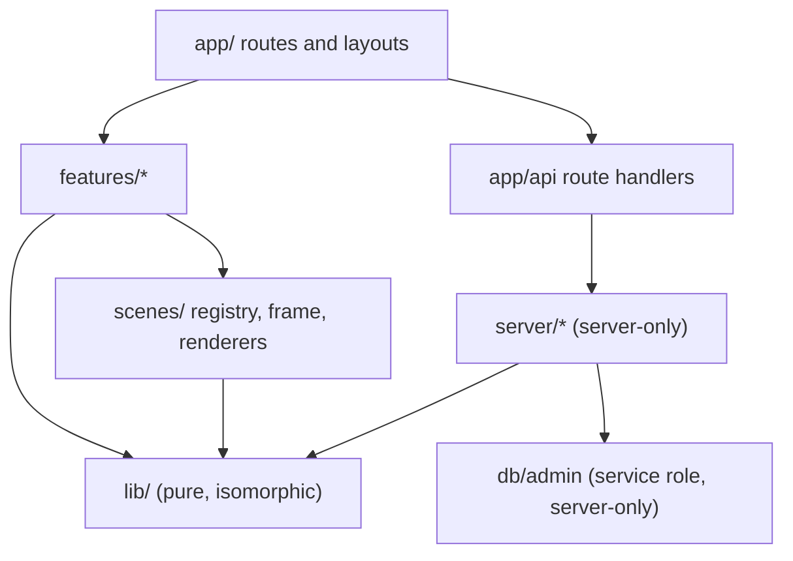
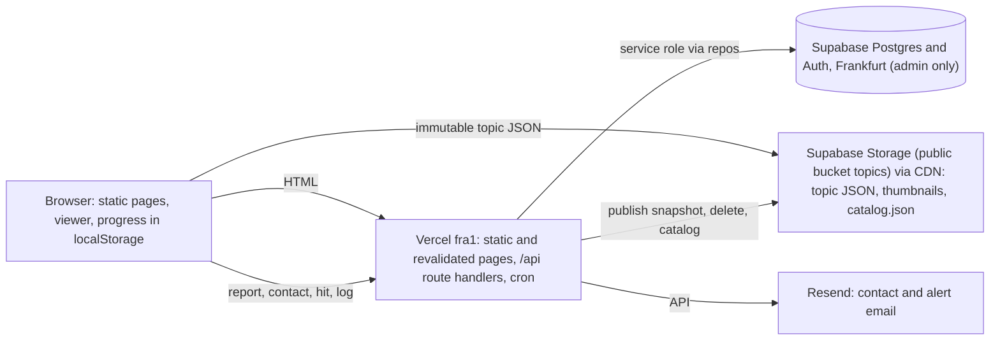
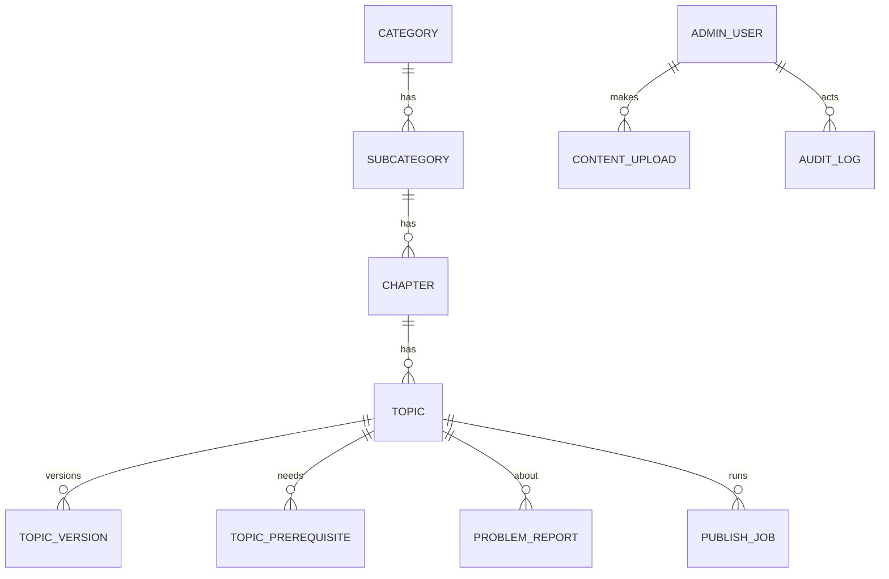

# Architecture Spine, Visual Math version 1

## Design Paradigm

Modular monolith, one TypeScript package, one deployable, one database (SRS section 3). A topic is data; a scene type is code. Nothing a topic contains is ever executed: a topic names a scene type from a registry and supplies parameters and whitelisted expressions, and trusted code does the rest (FR-9.15, NFR-2.7).

The browser draws every scene and runs the topic, so moving a slider makes no network call. The server delivers the math tree and topics, validates and stores uploads, and runs the admin panel. There is no visitor account, no visitor write path except Report a problem and Contact, and no visitor personal data (NFR-2.2).

| Layer | Path | Role |
| --- | --- | --- |
| lib | `src/lib/` | Pure, isomorphic, no framework or I/O: `expr`, `topic-schema` (incl. `parseMd`), `text` (inline markup, `renderMath`, search normalization), `format` |
| scenes | `src/scenes/` | Scene registry, shared `frame/`, renderers (2D SVG, 3D chunk); depends on `lib` only |
| features | `src/features/` | Library, search, map, viewer, progress, help, contact, admin UI and client logic |
| server | `src/server/` | Upload service, admin auth, audit, jobs, ratelimit, mail, repositories; `server-only` |
| db | `src/db/` | Supabase clients: `admin` (service role, server-only) and `auth` (anon key, admin sign-in only) |
| app | `src/app/` | Next.js routes, layouts, `api/` route handlers; composition only |
| content | `content/` | Topic sources (archive and fixtures), not shipped as code |

## Invariants & Rules

Dependency direction (a rule, lint-enforced with `eslint-plugin-boundaries`):



No arrow, no import. `lib` imports nothing from the repo. Client bundles never import `server/` or `db/admin`. `db/admin` is importable only from `server/repos`, `server/jobs`, `server/auth`, `server/audit`, `server/upload` (lint).

### AD-1 — Modular monolith, content-as-data [ADOPTED]

- **Binds:** all, FR-3.30, FR-9.15, NFR-2.7
- **Prevents:** content that carries behavior; per-topic code; a second deployable creeping in
- **Rule:** One package, one deployable, no microservices. A topic is a JSON or MD file read into one object validated against `lib/topic-schema`. Behavior lives only in registered scene types and in `lib/`. No `eval`, `Function`, dynamic `import()` from content, HTML or URL fields in topics, ever; enforced by ESLint (`no-eval`, `no-new-func`, no dynamic import of non-literal paths) and a CI grep of the built bundle. A new scene type is a code change and a registry entry; a new topic is data only.

### AD-2 — Scene contract and registry [ADOPTED]

- **Binds:** FR-3.17 to 3.30, FR-4.1, `topic-format.md` section 2
- **Prevents:** the topic page branching on scene type; renderers reading global state; unknown content silently ignored; a scene version bump breaking stored topics; injected markup through scene output
- **Rule:** A scene is declarative JSON `{type, v, ...typed fields}`; the topic carries `schemaVersion`. `src/scenes/registry.ts` maps `type@v` to `{schema, render2D, render3D?, static2D, partIds, describe}`; the topic schema is a union over registered `(type, v)` pairs; an unregistered pair fails upload (E_UNKNOWN_SCENE_TYPE). A `type@v` used by any stored topic version is never removed (CI query), and a contract change is a new `v`. A pure `migrate(doc)` chain upgrades older documents at read. Renderers are pure functions of `(scene, params)`; the only state they hold is camera and view toggles, which live in the scene frame (AD-15). Every 3D type implements `static2D` (FR-3.14). Renderers return React element trees, never an SVG or HTML string; every topic-derived DOM id is prefixed `tpc-{instanceId}-{id}`; every emitted coordinate is clamped to a finite window and path point counts are capped. Style uses color tokens, never hex (AD-11). Wave 1 needs scene types for FR-3.11 (net) and FR-3.27 (matrix) in addition to the Must set (PRD section 14).

### AD-3 — One expression module [ADOPTED]

- **Binds:** FR-3.6 to 3.8, FR-4.4, NFR-1.2, NFR-6.2, `topic-format.md` section 3
- **Prevents:** a second evaluator drifting from the validator; a library sandbox escape executing AI-written input; a valid topic that freezes a phone
- **Rule:** `src/lib/expr/` is the only code that parses or evaluates an expression string, at upload and at runtime, including the typed value beside a slider (FR-3.7). Whitelist grammar, whitelisted functions, compiled to a closure over a frozen AST; no `eval`, no `new Function`. `mathjs` and `expr-eval` are never used on topic input (mathjs RCE CVE-2026-41139 and CVE-2026-40897; expr-eval CVE-2025-12735). Domain errors return NaN. One budget, two levels: 20000 steps per evaluation call; an aggregate scene cost per frame computed at upload (samples x static node cost per element, loop bounds multiplied), rejected above 3,000,000 steps (E_SCENE_COST), stored on the version and re-checked by the renderer, which shows the static projection if exceeded. Builtins with unbounded work are capped by input (`nCr`, `nPr`, `binompmf` n at most 1000; `fact` at most 170). Upload stages run under a wall-clock limit. Property-based and fuzz tests are required for changes (AD-27).

### AD-4 — Topic upload pipeline and publish gate [ADOPTED]

- **Binds:** FR-9.2 to 9.9, FR-9.15, FR-6.4, NFR-2.7, NFR-5.3, `topic-format.md` sections 4 and 5
- **Prevents:** an unvalidated topic reaching visitors; a failed upload changing published content; two write paths into topic content; a half-translated topic going live
- **Rule:** Stages run in order and stop at the first failing stage: S0 body limit (streamed, 1 MiB per file, at most 12 files per request), JSON or MD parse, NFC normalization and bidi-control rejection; S1 strict Zod; S2 references and math tree; S3 expression whitelist and caps; S4 LaTeX allowlist and text rules; S5 recompute (formula checks and identities, example numbers, step solver lines, aggregate scene cost); S6 both locales present. Files are judged alone; a failed file saves nothing and each problem is reported with file, field and message. A valid file creates a `topic_version` (AD-19) in `draft`; importing content whose hash already exists returns the existing version. **Publish is a separate admin action**; it is allowed only for a valid version with both locales (FR-6.4) and is the admin's accuracy and Urdu check (NFR-6.3, 6.4). Uploading an id that already exists creates a new draft version and leaves the published one live until the admin publishes the new one (FR-9.8). The upload service is the only writer of topic content; there is no form editor in v1. The file archive in `content/topics/` is a second copy, written by export (FR-9.16), never read back over a stored topic without going through this pipeline. The PRD 8a "quality bar" with a second Claude pass of the first architecture is dropped; formula and example checks are part of S5 and run on every upload (NFR-6.2).

### AD-5 — Topic i18n shape [ADOPTED]

- **Binds:** FR-6.1 to 6.5, FR-3.28, NFR-7.1 to 7.4, `topic-format.md` section 1.3
- **Prevents:** Urdu text breaking KaTeX layout; per-locale topic forks; an unfinished translation shown as complete; a new language needing a schema change
- **Rule:** Every topic string is a per-locale map generated from the one `LOCALES` list (a test adds a fake locale and asserts the schema accepts it); both locales ship in one topic file. Formulas are LaTeX rendered `dir="ltr"`; Urdu prose never appears inside `\text{}` or `$...$`; authored digits are Western and converted only for display outside math. A Must string missing in `ur` rejects the upload (E_LOCALE_MISSING), so no stored topic is incomplete; the admin list still shows per-language completeness (FR-9.12). Interface text lives in next-intl message files, never in code (FR-6.5). The language is part of the path, `/en/...` and `/ur/...` (FR-6.6). The first language comes from `Accept-Language`, English if unsupported (FR-6.3); the choice is remembered in `localStorage` and a locale switch keeps the visitor's place (FR-2.7).

### AD-6 — Viewer state model [ASSUMPTION]

- **Binds:** FR-3.6, FR-3.7, FR-4.3, FR-4.4, FR-2.5, FR-2.7, NFR-1.2
- **Prevents:** step changes wiping slider values; formulas, scene and readouts showing different numbers; language switch losing place; hostile URL state
- **Rule:** One client store `{params, touched, stepIndex, exampleInputs, locale}`. Mutations happen only through named actions (`setParam`, `enterStep`, `setExampleInput`, `resetAll`) exported from `features/viewer/store`; no other module imports the setter (lint). A visitor write (slider, drag, typed value, URL restore) adds the parameter to `touched`; a step's `sceneState.params` presets apply only to untouched parameters; `touched` is not serialized. Derived values, formulas, readouts and scenes are computed from `params` in one pass per change; slider to paint stays under 100 ms. `resetAll` (FR-2.5) restores start values and the starting camera. `stepIndex` and `params` are URL-serializable and read only on the client through `parseUrlState(doc, searchParams)` in `lib/`: null-prototype object, unknown keys dropped, values clamped to range and grid; fuzzed. A locale switch is a client-side navigation that keeps `stepIndex` and `params`.

### AD-7 — Data ownership and content delivery [ADOPTED]

- **Binds:** FR-1.6, FR-1.9, FR-9.4, FR-9.5, FR-9.7, NFR-1.1, NFR-1.3, NFR-5.3
- **Prevents:** two systems of record; mutable topic URLs that break caches; the public site reading drafts; a private object landing in the public bucket
- **Rule:** Postgres on Supabase (Frankfurt) is the system of record. A topic version is validated JSONB in `topic_version` (AD-19). Publishing writes the snapshot to the one public Storage bucket `topics` as `topics/{id}/{contentHash}.json`, `Cache-Control: public, max-age=31536000, immutable`, which is safe only because unpublish deletes the object (AD-20). `catalog.json` is generated, never patched (AD-20). Exactly one public bucket exists, writable only by the service role; every other bucket (exports, dumps) is private with signed URLs of at most 10 minutes; CI asserts the bucket list. Visitors read published topics only as immutable JSON by hash through the CDN. The viewer takes its document as a prop; the public route loads it from the bucket. The admin Preview (FR-9.4, 9.5) is a route in the dynamic admin group that loads the draft from Postgres through an admin-only handler, `Cache-Control: no-store`, `noindex`, and never writes drafts to any public bucket. The upload service is the only writer of topic content (AD-4). The SRS entities listed in section 6 live as tables (AD-22); steps, parameters and formulas live inside the topic JSON, not as tables.

### AD-8 — Admin access and authorization [ADOPTED]

- **Binds:** FR-9.1, FR-9.5, FR-9.13, NFR-2.4, NFR-2.6, NFR-2.8
- **Prevents:** a visitor reaching admin data; a forgotten check on one route; an admin without a second step; a client holding database access
- **Rule:** The only users are admins. Sign-in is Supabase Auth email and password with TOTP (authenticator app); every admin route handler and every admin page requires an `aal2` session and a row in `admin_user` (`requireAdmin()`), re-checked on the server per request, never from a client flag. Admin accounts are created by migration or seed only; there is no sign-up. Row Level Security is enabled on every table with no policy for `anon` or `authenticated`: the browser has no database access at all. The server reaches the database through `server/repos` with the service-role client (AD-9). Recovery codes are kept offline by the owner. Brute force is limited by Supabase Auth limits in `supabase/config.toml` plus the app limiter (AD-28). Every admin action writes `audit_log` (AD-17). Migrations are checked in CI: a table without RLS fails; default privileges are revoked for `anon` and `authenticated`; views are `security_invoker`.

### AD-9 — Mutation path and server-only boundary [ADOPTED]

- **Binds:** NFR-2.6, NFR-2.7, NFR-2.8, FR-2.4, FR-9.x, FR-12.2
- **Prevents:** a client holding the service-role key; mutations authorized by UI state alone; per-handler rate limiters with different keys; error leakage
- **Rule:** The service-role key and signing secrets exist only in `server-only` modules and server env vars never prefixed `NEXT_PUBLIC_`; CI scans the built client bundle for the key prefix. Every mutation is a Route Handler under `/api/` on Web-standard `Request`/`Response`: admin handlers call `requireAdmin()` first, public handlers (`report`, `contact`, `hit`, `log`) call `server/ratelimit`; both validate the body with Zod. A handler lacking one of them fails lint. No Server Actions. Cookie-session routes require an `Origin` match and `SameSite=Lax`. Error envelope `{error: {code, message, details?}}`: `details` carries only Zod issue paths or the upload error list; database errors map to `internal` plus a request id, never forwarded.

### AD-10 — Rendering model and routes [ADOPTED]

- **Binds:** FR-1.x, FR-1.6, FR-1.9, FR-6.6, NFR-1.1, NFR-1.5, NFR-7.1
- **Prevents:** static pages that quietly become dynamic; a stale published topic page; locale routing diverging
- **Rule:** Next.js 16 App Router, React 19, TypeScript strict. Home, category, chapter, topic, search, map, help, about, privacy, terms and FAQ pages are generated statically per locale under `/en` and `/ur` (`generateStaticParams`; `dynamicParams` on so topics published after the build render on demand). They carry server-rendered text and KaTeX HTML and never read cookies, headers or `searchParams` on the server (URL state is client-only, AD-6); they are revalidated by tags `topic:{id}` and `catalog` through the one helper of AD-20. At render time the page reads published state from Postgres (`topic.published_hash`), not from the CDN; an unpublished or deleted topic renders only a friendly "not available" shell (FR-1.9, FR-1.10). Admin pages are a separate dynamic route group. `proxy.ts` (Node runtime) redirects `/` by `Accept-Language` and refreshes the admin session on the admin group only. `<html lang dir>` is set by the locale layout. CI inspects the build output and fails if any visitor route listed above is dynamic. A topic page preloads the hashed JSON; at hydration it re-reads `catalog.json` (`no-cache`) and refuses to start a topic the catalog no longer lists as published. Search engines read each page's server-rendered title and summary (SEO).

### AD-11 — Theme tokens [ADOPTED]

- **Binds:** DESIGN.md tokens, NFR-3.1, FR-3.x scene colors
- **Prevents:** hard-coded colors; scenes that do not recolor in dark mode; unvetted contrast pairs
- **Rule:** DESIGN.md frontmatter (the Quiet Study theme, unchanged) is the single source; a build script generates `tokens.css` (`:root`, `[data-theme="dark"]`) and a typed `tokens.ts`. Components and scenes use variables only; 3D reads them through `getComputedStyle` (cached, refreshed on a theme event) and recolors without remounting. The topic `ColorToken` set maps one-to-one to the DESIGN.md scene tokens. Theme, language, digit set and reduced-motion preference are applied before paint by one constant inline script reading `localStorage` (its sha256 is in the CSP, AD-17). A new color pair must be added to the DESIGN.md contrast table first; CI lints hex literals outside the token build.

### AD-12 — Direction and fonts [ADOPTED]

- **Binds:** FR-3.28, FR-6.2, NFR-1.6, NFR-7.3, DESIGN.md Urdu typography, EXPERIENCE RTL rules
- **Prevents:** math and axes mirrored in Urdu; Nastaliq clipped or blocking render; mirrored arrow keys on 3D
- **Rule:** CSS logical properties only (lint bans physical properties in app code). Mirror: page chrome, nav, step arrows, progress bars, text panel, slider track. Never mirror: scenes and axes, KaTeX, numbers and units, camera and arrow-key rotation mapping, unit circle. Scene frames, formulas and inline math are `dir="ltr"` with `unicode-bidi: isolate`; foreign spans carry their own `lang`. Fonts are self-hosted: Latin system stack, KaTeX fonts for math, Noto Nastaliq Urdu subset to the Arabic ranges with layout features kept, WOFF2, `font-display: swap`, loaded only on `/ur`, with a fallback shown first (NFR-1.6). Foundation sizes are a root class chosen from the topic level, reusing the same viewer. Real-device RTL checks are a release gate.

### AD-13 — Scene rendering and performance tiers [ADOPTED]

- **Binds:** FR-3.1 to 3.4, FR-3.13, FR-3.14, NFR-1.1 to 1.3, NFR-4.3
- **Prevents:** three.js in every page's bundle; a runaway render loop on a phone; no usable fallback on weak devices
- **Rule:** Three tiers per scene. Tier A: 3D via `@react-three/fiber` in a lazy chunk (`ssr: false`), `frameloop="demand"` with `invalidate()` on param change, `dpr` capped `[1, 1.5]`, `PerformanceMonitor`, geometry and material reuse, dispose on unmount, no shadows or postprocessing, context-loss handled. Tier B: light 2D from `static2D`; 2D scene types never load the 3D chunk (NFR-1.3, SRS 2.4 "older or shared computers need a lighter 2D mode"). Tier C: the static projection plus the FR-3.14 message. Drop to B or C when WebGL is absent or fails; offer B after 8 s without first interactive and remember the choice per device in `localStorage`. 2D scenes use one custom SVG renderer calling `lib/expr` closures. Reduced motion disables sine-wave, fill and net animations behind a Play button (NFR-3.3). Initial JS budgets are CI-enforced (seed values below).

### AD-14 — Rendering of untrusted text [ADOPTED]

- **Binds:** FR-3.28, FR-4.6, NFR-6.2, `topic-format.md` sections 1.3 and 5
- **Prevents:** stored XSS through math or markup; upload and runtime rendering a formula differently; LaTeX injection through placeholders; `dangerouslySetInnerHTML` scattered across the code
- **Rule:** All math goes through `lib/text/renderMath(latex, {inline})` with one frozen options object (`trust: false`, `strict: 'error'`, `throwOnError: true`, `maxSize: 20`, `maxExpand: 200`, `output: 'htmlAndMathml'`) imported by the upload service, the server render and the client; a unit test asserts there is one object. The command policy is an allowlist; a KaTeX upgrade must pass the allowlist test and the fixture corpus. `\text{}` is ASCII only. Formula and example placeholders accept only `^-?\d+(\.\d+)?$` or the code-inserted `\text{undefined}`, else a dash. The `text` module returns React nodes or typed tokens, never an HTML string; `dangerouslySetInnerHTML` appears only in one `MathHtml` component fed by `renderMath` (lint). Metadata, `aria-label` and search tokens use the markup-stripped plain form from the same module. Visitor-supplied text (problem reports, contact messages) is length-capped, NFC-normalized, stripped of control and bidi-override characters on write, and always rendered as text in the admin, under the stricter admin CSP.

### AD-15 — Scene frame and common controls [ADOPTED]

- **Binds:** FR-3.1 to 3.4, FR-3.15, FR-3.29, FR-2.8, NFR-3.1 to 3.3, EXPERIENCE keyboard rules
- **Prevents:** each scene type implementing rotate, zoom and keys differently; mirrored or missing keyboard control; renderers owning camera state
- **Rule:** `scenes/frame` is the one module owning rotate, zoom, pan, Reset view, Full screen, the Zoom in, Zoom out and Move picture buttons, arrow-key rotation (5 and 15 degrees), Esc and Tab behavior, the `role="img"` to `role="application"` switch, camera presets, tier switching, the 8-second light-mode offer and the first-time hint (FR-2.8, dismissal remembered in `localStorage`), for 2D and 3D alike. Renderers receive camera and input only through the frame and never import `OrbitControls` or attach their own listeners (lint). Camera and view toggles are the only state outside `params` and live in the frame. Accessibility conventions: one polite live region fed by `readouts` with a 500 ms debounce, KaTeX MathML output kept, 200% text reflow, focus order identical in both directions. Full screen (FR-3.15) uses the Fullscreen API with a maximized-frame fallback.

### AD-16 — Feature flags and the version 2 seams [ADOPTED]

- **Binds:** FR-7.1, FR-10.5, FR-8.11, FR-11.1, SRS sections 3 and 9
- **Prevents:** building version 2 inside version 1; a flag baked into a static build; a device identifier created without a legal basis; a later rebuild instead of a switch
- **Rule:** Settings live in `setting(key, value)`: `free_allowance_enabled` (false), `subscriptions_enabled` (false), `free_topics_count` (3). The admin edits them (FR-10.5) and the admin dashboard shows them; **no visitor code reads them in version 1**, so every topic is free (FR-7.1). Nothing for version 2 is shipped: no device id, no account table, no payment code, no `/api/flags`. The seams are only (1) the settings store, (2) the `quiz` field reserved in the topic format, (3) the topic JSON being fetched through one `loadTopic(id)` function, so a version 2 gate (device id, server count, signed delivery for locked topics) has a single place to attach, and (4) route and table names that do not collide with version 2 names (`/account`, `/plans`, `device`, `user`, `subscription`). A later hard limit would need server-checked delivery of non-free topics; the SRS requires the count to be checked on the server (FR-7.5), so version 2 changes the delivery of the topic JSON for locked topics. The Plans page (FR-8.11, S) says "free for now"; its waiting-list form, if built, stores an email under explicit consent in `waitlist` and is listed in the privacy policy (PRD section 14 item 4).

### AD-17 — Privacy and compliance invariants [ADOPTED]

- **Binds:** NFR-2.1, NFR-2.2, NFR-2.6, NFR-2.8, NFR-2.10, FR-9.13, FR-12.2 to 12.4
- **Prevents:** visitor data stored by accident; trackers entering through a dependency; an audit trail that is missing or editable; a CSP that is loose in practice
- **Rule:** (1) Visitors are never identified: no visitor accounts, no device id, and no cookie except one functional first-party cookie, `vm-locale` (`en` or `ur`), set only when the visitor presses the language switcher so the redirect from `/` can honor it (decided in Story 1.3; the Privacy page names it). The server stores about visitors only what they submit: a problem report (topic id, note) and a contact message (optional email, message), plus the transient rate-limit keys of AD-28. (2) All data in EU storage; processing hosts are also EU where the service offers it. (3) `audit_log(id, admin_id, action, target, time)` is append-only by privilege (UPDATE and DELETE revoked); every upload, publish, unpublish, delete, restore, tree change and flag change writes one row in the same transaction as the change (FR-9.13). (4) No third-party scripts, trackers, ads or fonts. CSP, no `unsafe-inline` in `script-src` ever: `default-src 'self'; script-src 'self'` plus sha256 allowance only for the constant inline scripts we own (AD-11) and Next's integrity-checked bundles (`experimental.sri`; nonces are forbidden because they force dynamic rendering); `style-src 'self' 'unsafe-inline'` (KaTeX and React style attributes); `object-src 'none'; base-uri 'self'; form-action 'self'; frame-ancestors 'none'; connect-src 'self'` plus the Supabase origin; the admin group is stricter. Playwright fails on any third-party request, any CSP violation and any inline script without a hash. [ASSUMPTION: Next 16 static plus on-demand revalidated pages can run under SRI-only `script-src`; verified in a first-story spike, AD-29; if it cannot, the owner decides, `unsafe-inline` is not the fallback.] (5) Browser storage (FR-12.4): essential storage is theme, digit set, reduced motion, the dismissed scene hint and the 3D tier choice; the optional key is progress (AD-18). The saved language is the `vm-locale` cookie (item 1) and is listed with them. A notice lists them and offers "Save my progress on this device" on or off; declining turns progress off and removes the key. Legal review (NFR-2.10) decides whether the notice is required per country; it is built so it can be shown or hidden by setting. (6) Retention: error log 30 days, reports and contact messages kept until handled plus 12 months, rate-limit keys 1 hour, audit log 12 months, purged by the daily job.

### AD-18 — Progress on the device [ADOPTED]

- **Binds:** FR-5.1 to 5.4, FR-1.3, NFR-2.2
- **Prevents:** progress leaking to the server; two progress formats; a corrupt or hostile stored value breaking the page
- **Rule:** Progress is one `localStorage` key `vm.progress.v1`: `{v: 1, topics: {topicId: {viewedAt, lastStep}}, last: topicId}`. It is read and written only by `features/progress`, which validates the whole value with Zod on read and discards it if invalid. A topic is marked viewed on its first scene interaction or on reaching its last step (FR-5.1). My progress groups viewed topics by category from `catalog.json` and ignores ids not in it (unpublished topics); the Continue button opens `last` (FR-5.3). Clear progress deletes the key (FR-5.4). Nothing in this feature calls the network (FR-5.2); a test asserts no request is made when a topic is marked viewed. Progress is optional storage under AD-17 (5). Version 2 may merge these marks into an account (FR-5.5); the versioned shape allows it.

### AD-19 — Topic identity, versions and deletion [ADOPTED]

- **Binds:** FR-9.7 to 9.9, FR-9.11, FR-9.12, SRS section 6.2
- **Prevents:** three identities for one version; two published versions of a topic; slug reuse; a published topic edited in place; a deleted topic lost at once
- **Rule:** `topic(id slug PK, chapter_id, level, chapter_order, wave, latest_hash, published_hash null, deleted_at null)` and `topic_version(topic_id, content_hash, seq, doc, cost, created_by, created_at, published_at null)` with PK `(topic_id, content_hash)`. `published_hash` is the only publication state; null means unpublished, and it references an existing version, so two published versions are unrepresentable. `content_hash` is `sha256:` of the canonical JSON from `lib/topic-schema/canonicalize` (strings NFC, keys sorted, no whitespace), with golden test vectors. Published topics are never edited in place (SRS 6.2): every change is a new version; earlier versions are kept. Restore (FR-9.9, S) copies an earlier version's document into a new draft version; publishing it stays an explicit action. Slugs are permanent and never reused. Delete (FR-9.11) is allowed only when unpublished and sets `deleted_at`; the topic disappears from lists and links but stays restorable for 30 days; the daily job then hard-deletes it and its versions. A deleted slug stays reserved.

### AD-20 — Catalog and the publish and unpublish saga [ADOPTED]

- **Binds:** FR-9.7, FR-1.2, FR-1.3, FR-1.4, FR-1.9, NFR-1.1, NFR-5.3
- **Prevents:** a hidden topic staying live; a lost update on `catalog.json`; each route revalidating its own paths; a regenerated page re-publishing from a stale catalog
- **Rule:** `catalog.json` is generated, never patched: `rebuildCatalog()` reads all rows from Postgres under an advisory lock and writes a new object `{version, generatedAt, tree: [{category, subcategory, chapter, name {en, ur}, order, count}], topics: [{id, hash, path, chapterOrder, level, estimatedMinutes, title, summary, prerequisites, next, searchTokens, thumb}], tombstones: [{id}]}`, typed in `lib/topic-schema/catalog.ts`, versioned, `Cache-Control: public, max-age=30`; split per category when a file would exceed the budget. Publish: write the object, then one transaction sets `published_hash` and inserts a `publish_job`. Unpublish: one transaction sets `published_hash = null` and inserts the job; the job then (a) deletes all `topics/{id}/*` objects, (b) runs `rebuildCatalog()`, (c) calls the single `revalidate()` helper, which maps events to cache tags `topic:{id}` and `catalog` and is the only place that enumerates affected pages (topic in both locales, chapter, category, home, map, neighbours). The request runs the job inline; a failed step is retried with backoff by the five-minute cron (AD-28), shown in admin and alerted after three failures. Publish and unpublish of one topic serialize on an advisory lock. The thumbnail is a small SVG (at most 4 KB) rendered at publish from the topic's `static2D` with `renderToStaticMarkup`, stored at `topics/{id}/{hash}.thumb.svg`, shown as ``, deleted at unpublish. Accepted residue: browsers that already cached the JSON keep a copy; the viewer refuses to start a topic the catalog no longer lists as published; crawlers see only the shell after revalidation. Target: effective within 60 seconds (FR-9.7), proven by e2e. [ASSUMPTION: Supabase CDN honors deletion and `max-age=30` within that bound; verified in a spike, AD-29.]

### AD-21 — Search [ASSUMPTION]

- **Binds:** FR-1.4, FR-1.5, NFR-1.5, NFR-7.x
- **Prevents:** two search normalizations; Urdu queries missing results; a server round trip per keystroke
- **Rule:** Search is client-side over `searchTokens` in the catalog (title, summary and tags of the current language, FR-1.4), built and queried by the one `lib/text` `normalizeSearch`: fold U+064A and U+06CC, U+0643 and U+06A9, drop diacritics and ZWNJ, map Eastern digits to Western, case-fold. Results show their category path and can be filtered by category and level (FR-1.5). With 48 topics at launch and about 600 at full coverage the catalog stays small; the answer time is far below 1 second. The result count is announced to the live region. No server search in version 1.

### AD-22 — Math tree and data model [ADOPTED]

- **Binds:** FR-9.10, FR-9.12, FR-9.13, FR-10.5, FR-10.6, FR-2.4, FR-12.2, SRS section 6
- **Prevents:** import validating against a different tree than the site shows; agents inventing tables differently; the tree frozen in code when the admin must edit it
- **Rule:** The math tree is data in the database, edited by the admin (FR-9.10): `category(id slug, name_en, name_ur, order)`, `subcategory(id, category_id, ...)`, `chapter(id, subcategory_id, ...)`, loadable from an uploaded tree file validated like a topic (names in both languages, unique slugs, valid parents). The upload service validates `path` against these tables; `rebuildCatalog()` builds the tree and counts from them. Reordering or renaming triggers the same publish saga for the catalog (AD-20). The twelve categories are seeded at first deploy. Tables in version 1 (snake_case, singular): `category`, `subcategory`, `chapter`, `topic`, `topic_version`, `topic_prerequisite` (derived from the topic at publish; feeds the map), `content_upload`, `setting`, `problem_report`, `contact_message`, `admin_user`, `audit_log`, `publish_job`, `rate_limit`, `error_log`, `usage_counter`; `asset` is added when images (FR-9.14, S) are built; `waitlist` only if the waiting-list form is built (AD-16). The marked-term definitions (FR-2.6) live in the topic, not in a global glossary table.

### AD-23 — Hosting and deploy topology [ASSUMPTION]

- **Binds:** SRS 2.1, 2.4 and 3, NFR-1.1, NFR-5.1
- **Prevents:** accidental Vercel lock-in; EU compute drifting to a US default region; surprise spend
- **Rule:** The SRS wants an EU-hosted system behind a global CDN with edge points in Asia and Europe, and asks the architect to confirm the suggested stack. Confirmed: Vercel Pro (Hobby terms allow only personal or non-commercial use; Pro is $20 per deploying seat per month with a $20 credit; Auto Approval of private-repo committers is off) with functions pinned to `fra1`, global edge caching for static pages; Supabase Pro in `eu-central-1` (fixed at creation) with Storage behind its CDN for topic JSON. A Vercel spend alert is set. Monthly budget is unknown. Portability to Cloudflare Pages is weakened, not preserved: mutations are Web-standard Route Handlers (AD-9), static routes read no cookies or headers (AD-10), topics and catalog come from Storage (AD-7), but tag-based revalidation (AD-20) has no Cloudflare equivalent. Vercel-coupled code is isolated in `server/platform`. [ASSUMPTION: this CDN setup is fast enough in Asia as well as Europe; measured after launch (SRS 11.2).]

### AD-24 — Environments, secrets, CI/CD [ASSUMPTION]

- **Binds:** NFR-6.1, NFR-6.5, NFR-2.x
- **Prevents:** config drift between environments; secrets in the client bundle or git; a pull request reading production keys; unreviewable schema changes
- **Rule:** Local (Supabase CLI stack), preview, production (staging is added only if the owner wants it). Preview deployments never receive the production service-role key: they use a throwaway Supabase schema with its own low-privilege key and synthetic data. Secrets live only in Vercel encrypted variables and Supabase; none in git; secret scanning in CI; only an allowlist of `NEXT_PUBLIC_` variables (Supabase URL, anon key, Storage origin). Forward-only SQL migrations in `supabase/migrations/`, applied behind manual approval, expand-then-contract; code rollback is a Vercel instant rollback, schema rollback a forward fix. Node and TypeScript are pinned (Stack) in `engines`, the Vercel project setting and CI. CI on every pull request: typecheck, lint (boundaries, no hex, no physical CSS, `requireAdmin` or limiter on every handler), Vitest, upload dry run of fixtures, build and static-route check, bundle budgets and key scan, Playwright against the preview, migration dry run, RLS presence check.

### AD-25 — Backups and recovery [ADOPTED]

- **Binds:** NFR-5.2, NFR-5.3, SRS 6.2
- **Prevents:** losing content; an untested restore; a silently failing dump
- **Rule:** The SRS requires daily backups kept at least 30 days and a tested restore. Supabase Pro keeps daily backups for 7 days (PITR add-on gives 14 days for about $200 per month and disables daily backups). So a scheduled encrypted `pg_dump` of the `public` schema runs daily, is encrypted with `age` (private key held offline by the owner) and uploaded to EU object storage in a separate account with a 30-day lifecycle rule. [ASSUMPTION: the job host is a scheduled GitHub Actions workflow or a small EU VPS; the owner picks. The first architecture decided a 14-day dump; the SRS raises this to 30 days.] Topic sources in `content/topics/` (FR-9.16 export) are a second copy of content. A restore drill into a scratch project is a launch gate (NFR-5.2). Recovery time and point objectives are not set (Deferred).

### AD-26 — Observability and analytics [ASSUMPTION]

- **Binds:** FR-10.6, FR-10.7, NFR-2.2, NFR-5.1, SRS 7.3
- **Prevents:** a third-party SDK leaking visitor data; blind spots on a one-person operation; identifiers sneaking into usage numbers
- **Rule:** Deviation from the SRS suggestion (Plausible for analytics, Sentry for errors, which the SRS asks the architect to confirm): no third-party analytics or error SDK, so the CSP stays closed and visitor data never leaves the first party (SRS 7.3 asks only for "privacy-friendly" tools). Usage numbers (FR-10.7) come from `usage_counter(day, kind, key, count)` incremented by a rate-limited `/api/hit` beacon with no identifiers: one `visit` per browser session (a `sessionStorage` flag), one `topic_open` per topic per page load, and the language; "visitors per day" is therefore sessions per day, stated as such in the admin. Errors go to a first-party `/api/log` (rate-limited, scrubbed, no IP stored) into `error_log` and Vercel logs as structured JSON with a request id. An external uptime monitor checks `/api/health` and the catalog URL and receives job heartbeats (AD-28). Report a problem writes `problem_report(topic_id, note, created_at, handled)` and the admin groups reports by topic with counts and a link to the topic in admin (FR-10.6); reports are rate-limited per key and per topic and deduplicated.

### AD-27 — Repository and quality gates [ADOPTED]

- **Binds:** NFR-6.1, NFR-6.2, NFR-6.5
- **Prevents:** schema and evaluator regressions reaching visitors; agent-written code drifting from conventions; a doc and schema that disagree
- **Rule:** Single TypeScript package (no workspaces), strict mode. Vitest covers `lib/expr` (fuzz and property tests with fast-check, builtin caps, `__proto__` keys), `lib/topic-schema` (`canonicalize` golden vectors, `parseMd` against its JSON twin), `parseUrlState`, progress storage validation, and the upload stages against `content/fixtures/` (valid, and one invalid fixture per error code); every scene type has formula tests against known values (NFR-6.2). Playwright covers flows (shared Urdu link, step through a topic, search, progress on the device and clear, language switch keeping place, admin upload with errors then success, preview, publish and unpublish within 60 s across HTML, JSON URL and catalog, report a problem, contact). A generated field table from the Zod schema is diffed against `topic-format.md` in CI; the worked example is the single fixture; the schema wins a disagreement. Every story carries acceptance tests (NFR-6.5). `docs/coding-standard.md` and `AGENTS.md` are updated with the code. Launch gates: restore drill, real-device RTL, the spikes of AD-29, an accessibility pass (NFR-3.1), a usability test with real people (NFR-3.5).

### AD-28 — Operational services [ASSUMPTION]

- **Binds:** FR-12.2, FR-10.6, NFR-2.6, NFR-2.8, NFR-5.1
- **Prevents:** silent job failures; ad-hoc rate limiters; contact messages lost when email fails; an unsecured admin account; no owner alert path
- **Rule:** Email: Resend [ASSUMPTION, after a web check: documented EU sending region is Ireland eu-west-1; Resend's docs do not confirm account and log residency, so a data-processing and residency check is required before launch], through `server/mail`, only for contact messages to the owner and admin alerts; the contact message is stored first and the email is best effort, so a mail failure never loses a message (FR-12.2). The admin sign-in uses Supabase's own mail only for password reset, through Resend custom SMTP (the built-in SMTP is never used in production). Sender on a product subdomain with SPF, DKIM and DMARC. Scheduler: Vercel Cron calls token-protected idempotent `/api/jobs/*` for the daily purge (deleted topics after 30 days, retention), the `publish_job` retry (every 5 minutes) and the rate-limit sweeper. Rate limiting (NFR-2.8): Vercel Firewall rate rules on `/api/*`, plus the Postgres table `rate_limit(key, window_start, count)` with an atomic upsert behind `server/ratelimit`, the only way to limit in app code; keys are a daily-rotating salted hash of the IP, purged after 1 hour; contact form spam protection is a honeypot field, a minimum fill time and the limiter, with no third-party CAPTCHA. Domain: one product domain [OPEN: name and availability check, SRS 1.6] with DNS at the registrar, TLS by Vercel. Alerts (uptime, job heartbeats, publish_job failures, error spikes, spend) go to the owner by email and phone push; no on-call, response is best effort within the 99.5% target.

### AD-29 — Browser support and first-story spikes [ADOPTED]

- **Binds:** NFR-4.1 to 4.3, NFR-1.x, NFR-3.x
- **Prevents:** shipping a toolchain that silently breaks on the supported browsers; a Playwright matrix that tests the wrong devices
- **Rule:** The SRS requires the latest two versions of Chrome, Edge, Firefox and Safari (NFR-4.1) and phones from 360 px (NFR-4.2). The first architecture raised the floor to what the stack supports, and that stays as the build target because it is wider than the SRS requires: `browserslist` is `chrome 111, edge 111, firefox 128, safari 16.4, ios_saf 16.4, samsung 22`, the one source for build targets and the Playwright matrix (Next 16.4 default targets; Tailwind CSS 4 needs Chrome 111, Safari 16.4, Firefox 128; three.js needs WebGL 2 for Tier A, otherwise Tier B). The tested set is the SRS set plus iOS Safari and Android Chrome on a mid-range phone. Avoid utilities needing newer support (`field-sizing`, `@starting-style`, `text-wrap: balance`) without a fallback. Spikes that precede dependent stories: (1) static pages and the 3D and KaTeX rendering verified on a mid-range Android phone and an iPhone; (2) Supabase CDN behavior for immutable headers, object deletion and `max-age=30` on `catalog.json` (AD-20); (3) static and revalidated pages under the SRI-only CSP (AD-17); (4) topic pages build as static with next-intl root params (AD-10); (5) the measured Noto Nastaliq subset size against the 150 KB budget; (6) Supabase Auth TOTP enforcement (`aal2`) on admin routes (AD-8).

## Consistency Conventions

| Concern | Convention |
| --- | --- |
| Naming | Files and routes `kebab-case`; React components and types `PascalCase`; DB tables and columns `snake_case`, singular table names; scene `type` ids `kebab-case`; topic, step and part ids as in the format doc |
| Ids | Topics: slug (permanent). Versions: `(topic_id, content_hash)` with `sha256:<hex>` of canonical JSON (AD-19). Everything else: `uuid` database default |
| Dates and units | `timestamptz` in UTC, ISO 8601 on the wire; numbers, dates and prices formatted for the visitor's language and country (NFR-7.2); metric units; angles in degrees in topic data unless the parameter unit says `rad` |
| Result and error shapes | Pure code returns `Result<T, E>`, never throws for expected failures. HTTP errors `{error: {code, message, details?}}` with a stable `code`; upload errors use the `[CODE] pointer message` format and travel in `details` |
| Config | One typed `env.ts` validated with Zod at boot, server only; no `process.env` outside it |
| Logging | Structured JSON, request id, no personal data; levels `error`, `warn`, `info` |
| i18n | UI strings in next-intl message files keyed by feature; topic text only in the topic file; never concatenate translated fragments |
| State | Server state through route handlers and Supabase; client viewer state in one store (AD-6); no global mutable singletons in `lib/` |
| Auth in code | `requireAdmin()` and `ratelimit()` helpers; handlers without one fail lint; data access only through `server/repos` |
| Untrusted text | Math only via `renderMath`; text only via the `text` module; DOM ids from topics prefixed; `dangerouslySetInnerHTML` only in `MathHtml` (AD-14) |
| Accessibility | Scene `role="img"` with caption; one polite live region fed by `readouts`, debounced 500 ms; KaTeX MathML kept; every control meets DESIGN.md target sizes |

## Stack

| Name | Version |
| --- | --- |
| Node.js | 24 LTS, pinned (24.22.3 at authoring) in `engines`, Vercel and CI; Vercel's default must be overridden so local, CI and runtime match |
| TypeScript | 6.0.x (typescript-eslint peers below 6.1; TS 7 has no programmatic API until 7.1) |
| Next.js | 16.4.6 |
| React | 19.3.1 (react-three-fiber 9 requires react below 19.4) |
| three / @react-three/fiber / @react-three/drei | 0.187.0 / 9.8.2 / 10.7.9 (pin; v10 and v11 are alpha) |
| KaTeX | 0.19.1 |
| next-intl | 4.16.2 |
| Zod | 4.6.7 |
| YAML parser for MD front matter | `yaml` (YAML 1.2 core schema, no custom tags); version pinned at first use |
| Tailwind CSS | 4.3.5 (utilities mapped to the token variables; logical properties) |
| @supabase/supabase-js / @supabase/ssr | 2.119.2 / 0.12.7 |
| Supabase | Pro, `eu-central-1` Frankfurt; Auth for the admin only, Storage for published topics |
| Vercel | Pro, functions in `fra1` |
| Vitest / fast-check | 5.1.2 / 4.11.0 |
| Playwright | 1.65.1 |
| Noto Nastaliq Urdu | v4.000 (SIL OFL 1.1, verified in the font repo; keep the licence text in the repo), self-hosted WOFF2 subset |
| Resend | Transactional email for contact messages and admin alerts, EU region (AD-28) |

Not used: mathjs, expr-eval, JSXGraph, function-plot, Server Actions, nonce-based CSP, any third-party analytics, error SDK or CAPTCHA, Supabase client access to tables from the browser.

## Structural Seed

Containers and data flow:



Core entities (the SRS version 1 set; version 2 tables are not created):



`setting`, `contact_message`, `rate_limit`, `error_log` and `usage_counter` stand alone and are omitted from the diagram.

Seed budgets (measured and tuned at first build; CI fails above them): topic page initial JS excluding the 3D chunk 200 KB gzip; 3D chunk 450 KB gzip; Urdu font subset 150 KB WOFF2 (unmeasured); topic file at most 1 MiB (NFR-1.4), a typical topic under 100 KB gzip; catalog 150 KB gzip per file; scene cost 3,000,000 steps per frame; thumbnail 4 KB.

```text
visual-math/
  src/
    lib/            # expr, topic-schema (parseMd, canonicalize, catalog types), text, format (pure)
    scenes/         # registry.ts, frame/, 2d/ (SVG), 3d/ (lazy chunk), static2d/
    features/       # library, search, map, viewer, progress, help, contact, admin
    server/         # upload/, auth/, repos/, audit/, jobs/, ratelimit/, mail/, platform/
    db/             # admin.ts, auth.ts, types (generated)
    app/            # [locale]/ static visitor routes, (admin)/ dynamic group, api/
    i18n/           # locales.ts, messages/en.json, messages/ur.json
    styles/         # tokens.css (generated from DESIGN.md), fonts
  content/          # topics/ (archive), fixtures/
  supabase/         # migrations/, config.toml, seed (the 12 categories; synthetic data only elsewhere)
  tests/            # e2e/ (Playwright); unit tests sit beside code
  docs/             # coding-standard.md, runbooks/; AGENTS.md at root
```

## Capability → Architecture Map

| Capability / Area | Lives in | Governed by |
| --- | --- | --- |
| Browsing, tree, search, map (FR-1) | `app/[locale]`, `features/library`, `features/search`, `catalog.json` | AD-7, AD-10, AD-20, AD-21, AD-22 |
| Topic page (FR-2) | `features/viewer` | AD-5, AD-6, AD-10, AD-12, AD-15 |
| Visual engine (FR-3) | `scenes/`, `scenes/frame`, `lib/expr` | AD-1, AD-2, AD-3, AD-11, AD-13, AD-14, AD-15 |
| Topic content and steps (FR-4) | `features/viewer`, `lib/topic-schema` | AD-2, AD-3, AD-5, AD-6 |
| Progress on the device (FR-5) | `features/progress` | AD-17, AD-18 |
| Languages (FR-6) | i18n, layout, `styles/` | AD-5, AD-12 |
| Feature switches, Plans page (FR-7.1, 8.11, 10.5, 11.1) | `setting`, `features/admin`, topic format | AD-16 |
| Admin content tools (FR-9) | `features/admin`, `server/upload` | AD-4, AD-7, AD-8, AD-9, AD-19, AD-20, AD-22 |
| Admin system, reports, usage (FR-10) | `server/repos`, `problem_report`, `usage_counter` | AD-8, AD-26 |
| Help, contact, legal pages (FR-12) | `features/help`, `features/contact`, `server/mail` | AD-17, AD-28 |
| Privacy, audit, storage notice (NFR-2) | `server/audit`, notice component | AD-17 |
| Performance (NFR-1) | static pages, CDN, lazy 3D | AD-7, AD-10, AD-13 |
| Operations and quality (NFR-5, NFR-6) | CI, Vercel, Supabase, cron | AD-23 to AD-29 |

## Deferred

- Version 2: free allowance, device id, server-side count, accounts, subscriptions, payment, admin subscription tools (SRS 9.2 lists the switch-on conditions). Only the seams of AD-16 exist.
- Quizzes (FR-11.2, 11.3): the `quiz` field is reserved; marking, answer keys and an answer-input component are designed in that release.
- Images in topics (FR-9.14, S): schema version bump and the `asset` table when built.
- Recovery time and point objectives (AD-25).
- Hosting budget and a Cloudflare Pages move (AD-23).
- Dedicated discrete-maths scene types (graphs, trees, Pascal's triangle, modular arithmetic): the SRS FR-3 list has none; version 1 uses `canvas2d` and `stats`; "Proof by induction" and "Counting with permutations and combinations" are authored within that limit until these types exist.
- Scene transform helper element, balance-scale operation buttons, interactive algebra tiles: the first topic batch decides; each is a registry version bump.
- Urdu slider-track mirroring: UX decision awaiting confirmation with Urdu users; affects the slider component only.
- Legal review of privacy and consumer rules per target country (NFR-2.10) and whether the storage notice is needed per country (AD-17).
- Admin interface language (English only assumed).
